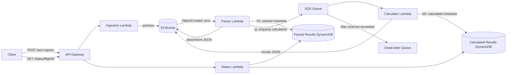

# Serverless Flight Position Report Processor

Production-minded learning project using .NET 8 Lambda functions and a TypeScript AWS CDK v2 application.[cite: 4]

## Architecture



## Repository[cite: 4]
* `application/FlightReportProcessor`: handlers, domain logic, and AWS adapters.[cite: 4]
* `tests/FlightReportProcessor.Tests`: credential-free xUnit tests.[cite: 4]
* `infrastructure`: TypeScript CDK stack.[cite: 4]
* `scripts`: local validation, deployment, smoke test, and cleanup.[cite: 4]

## Timestamp policy[cite: 4]
The report provides `ddHHmm`, not month/year. The resolver constructs candidates in the previous, current, and next UTC month relative to the ingestion or S3 event time, chooses the nearest candidate, and rejects a candidate more than 20 days away. All stored timestamps are UTC ISO 8601 values. The flight ID is `flightNumber + yyyyMMdd + departure + destination`.[cite: 4]

## Processing and idempotency[cite: 4]
The parser writes the attachment, then conditionally writes metadata, then sends SQS. A duplicate parsed timestamp is ignored and does not enqueue another calculation. S3 may contain an overwritten equivalent attachment after a retry, which is safe. The calculator returns partial batch failures so successful SQS items are not retried. It writes result JSON before a conditional metadata write. A rare crash between those operations can leave an unreferenced object; lifecycle policy eventually removes development data. After five failed receives, SQS moves a message to the DLQ.[cite: 4]
Status precedence is determined in application code; compare the latest item from each table; `CALCULATED` wins only when its timestamp is at least as new as the latest parsed state. Otherwise return `PARSED`. API ingestion itself returns `RECEIVED`, but this transient state is not persisted separately, so status may return 404 until parsing writes metadata.[cite: 4]

## Prerequisites[cite: 5]
* .NET 8 SDK. `global.json` pins feature band 8.0.408 with feature roll-forward.[cite: 5]
* Node.js 22 LTS and npm.[cite: 5]
* AWS CLI v2.[cite: 5]
* AWS CDK CLI from this repository (`npx cdk`), no global installation required.[cite: 5]
* Docker, because CDK builds the .NET Lambda asset in the runtime bundling image.[cite: 5]
* AWS credentials via IAM Identity Center (`aws configure sso`) or another short-lived credential provider. Do not commit credentials.[cite: 5]

## Local validation[cite: 5]
```bash
chmod +x scripts/*.sh
./scripts/local-test.sh
```[cite: 5]
This restores, builds, and tests .NET, then installs the locked npm dependencies, compiles TypeScript, and runs `cdk synth`. `npm install` creates `package-lock.json`; commit that lockfile, then replace automated installs with `npm ci` for reproducible builds.[cite: 5]

## Deploy[cite: 5]
```bash
aws configure sso
aws sso login --profile my-profile
export AWS_PROFILE=my-profile
export AWS_REGION=ap-southeast-1
./scripts/deploy.sh
```[cite: 5]
For a persistent environment, add `-c persistent=true` to CDK deploy/bootstrap commands. Persistent mode retains S3 and DynamoDB resources, enables bucket versioning and DynamoDB point-in-time recovery, and prevents automatic object deletion. Default development mode destroys data on stack deletion.[cite: 5]

## API examples[cite: 5]
Use the `ApiUrl` stack output, including its trailing `/`:[cite: 5]
```bash
export API_URL='[https://example.execute-api.ap-southeast-1.amazonaws.com/v1/](https://example.execute-api.ap-southeast-1.amazonaws.com/v1/)'
curl -i -X POST "${API_URL}pos-reports" -H 'Content-Type: text/plain' --data-binary 'POS/UL204.FR RGN/TO BKK/041205/N1642.3E09612.5/450/12500/2800'
curl -i "${API_URL}status/UL20420260904RGNBKK"
```[cite: 5]
Expected ingestion response: `202 {"flightId":"...","status":"RECEIVED"}`. Invalid bodies return 400. Status returns 404 until parser metadata exists, then `PARSED`, then `CALCULATED`.[cite: 5]

## Inspect and troubleshoot[cite: 3]
```bash
aws cloudformation describe-stacks --stack-name FlightPositionProcessorStack
aws s3 ls "s3://$BUCKET_NAME/" --recursive
aws dynamodb query --table-name "$PARSED_TABLE" --key-condition-expression 'flightId = :id' --expression-attribute-values '{"id":{"S":"UL20420260904RGNBKK"}}'
aws sqs get-queue-attributes --queue-url "$DLQ_URL" --attribute-names ApproximateNumberOfMessages
aws logs tail "/aws/lambda/<function-name>" --follow
```[cite: 3]
CloudWatch log group names and physical table names are available in the CloudFormation Resources tab or through AWS CLI stack-resource commands. Logs include flight identifiers and object keys, never full raw reports.[cite: 3]
To test retries, submit a syntactically valid report with an unknown destination, such as `XXX`. Parsing succeeds; calculation retries and then moves the message to the DLQ. After correcting the underlying cause in code, use `aws sqs start-message-move-task` to redrive messages. Malformed S3 objects should be quarantined operationally or deleted after examining logs; S3-triggered Lambda retries are managed by Lambda and are not sent to this SQS DLQ.[cite: 3]

## Calculation rules[cite: 3]
Great-circle distance uses the Haversine formula and a 3,440.065 nautical-mile Earth radius. Distance and fuel are rounded to two decimals, hours to four decimals, and total minutes to the nearest whole minute using midpoint-away-from-zero. The fuel warning is true only when the unrounded arrival fuel is negative. Ground speed must be positive; fuel and flow must be non-negative.[cite: 3]

## Security and cost[cite: 3]
S3 public access is blocked, TLS is enforced, and S3, DynamoDB, and SQS use managed encryption at rest. CDK grants prefix-scoped S3 access and operation-level table/queue permissions. API Gateway is public and intentionally unauthenticated for learning; add a JWT/Cognito authorizer, WAF, throttling, and request quotas before exposing it broadly. Main costs are Lambda invocations, API requests, CloudWatch logs/traces, S3 storage, DynamoDB on-demand requests, and SQS requests. Destroy development stacks and keep retention periods short.[cite: 3]

## Known limitations[cite: 3]
Airport lookup is intentionally small and embedded. No API authentication, custom domain, alarms, dashboards, schema versioning, or ingestion-state table is included. The parser uses the S3 event time as its date-resolution reference, so delayed/manual object uploads beyond 20 days are rejected. S3-to-Lambda poison events require operational recovery because the calculator DLQ only protects the SQS stage.[cite: 3]

## Cleanup[cite: 3]
```bash
./scripts/cleanup.sh
```[cite: 3]
Default development resources and data are deleted. Persistent resources are retained and must be deliberately emptied/deleted after changing their retention policy; CDK will not silently remove them.[cite: 3]
